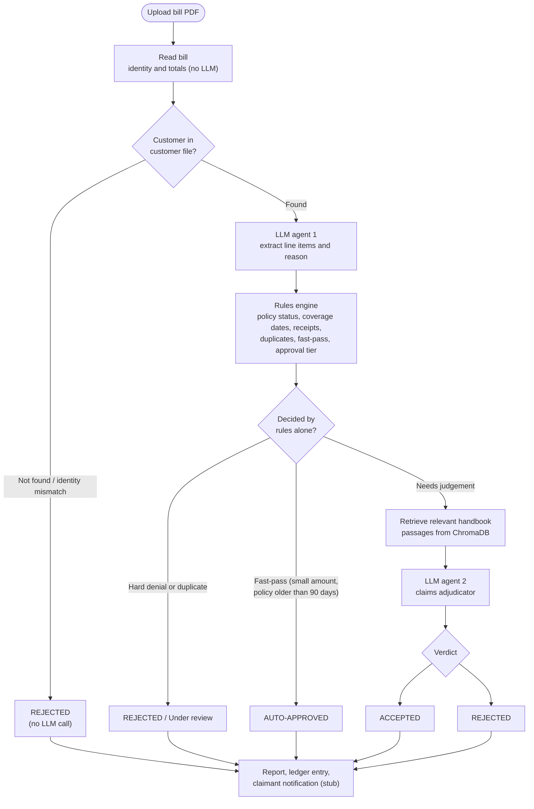
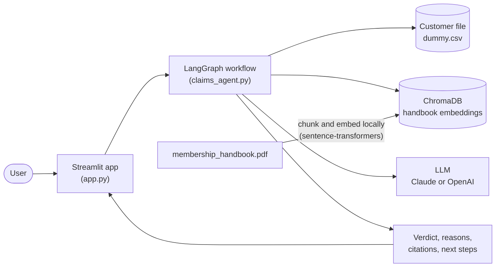

# 🛡️ Insurance Claims Processing Agent

**The problem:** insurance claims are still checked largely by hand. Someone reads each bill, confirms the customer and policy, compares the charges against the rulebook, and decides whether to approve. That is slow, inconsistent and expensive, and most of those checks are simple rules that don't need a person.

**The solution:** upload a hospital bill (PDF) and this agent reads it, verifies the customer, applies the claims rules, consults the policy handbook, and returns an **ACCEPTED / REJECTED** verdict with reasons, handbook citations and next steps.

Its key design choice: **deterministic checks run first and the LLM is used last.** An unknown customer is rejected with zero LLM calls, and claims that break a hard rule never reach the adjudicator. That keeps it cheaper, more predictable and easier to audit.

---

## How a claim flows through the system

Built as a [LangGraph](https://langchain-ai.github.io/langgraph/) workflow of small, single-purpose nodes:



## Architecture



## Tech stack

Python · LangGraph · LangChain · ChromaDB (vector DB) · sentence-transformers (local embeddings) · Claude or OpenAI · Pydantic structured output · pypdf · Streamlit · ReportLab (synthetic test bills)

## Quick start

```bash
pip install -r requirements.txt
export ANTHROPIC_API_KEY="sk-ant-..."     # Windows PowerShell: $env:ANTHROPIC_API_KEY="sk-ant-..."

streamlit run app.py                      # web UI: upload a bill and click "Process claim(s)"
# or, from the command line:
python claims_agent.py --bill bills/bill_C2001_olivia_bennett.pdf --no-persist
```

Set `CLAIMS_LLM_PROVIDER=openai` and `OPENAI_API_KEY` to use OpenAI instead. The handbook is embedded into `vector_db/` on the first run and reused afterwards.

## Sample data

`generate_bills.py` builds one synthetic bill per customer in `dummy.csv`, so every path can be tried:

| Bill | Expected outcome |
|---|---|
| `bill_C2001_olivia_bennett.pdf` | Approved by fast-pass (small balance, policy older than 90 days) |
| `bill_C2002_daniel_okafor.pdf` | Approved after LLM adjudication, routed to a Level 2 manager |
| `bill_C2003_marcus_reid.pdf` | Rejected: service date is before the policy start |
| `bill_C2004_hannah_kim.pdf` | Rejected: plan does not cover Health claims |
| `bill_X0000_alex_morgan.pdf` | Rejected: customer not found (no LLM call) |

The earlier sample set is kept in `previous_set/`. All data is fictional.

## Project structure

```
app.py               Streamlit UI (upload bills, live progress, results)
claims_agent.py      LangGraph workflow, rules engine, ChromaDB retrieval, CLI
generate_bills.py    Creates synthetic test bills from dummy.csv
dummy.csv            Customer file used for verification
bills/               Sample bills
membership_handbook.pdf   Knowledge base
```

## Notes

- This is a prototype. The handbook is a claims-processing rulebook, so coverage eligibility comes from the customer file (policy status, dates, covered claim types), and the LLM is instructed not to invent exclusions.
- The claimant notification is a stub, and decisions are only saved to a local ledger when you turn that option on.
- LLM verdicts can vary, so keep a human review step before using anything like this on real claims.
